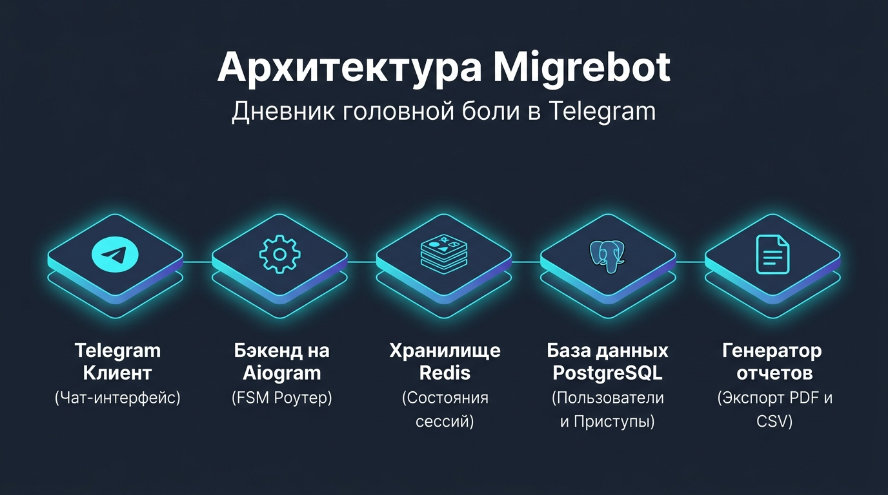
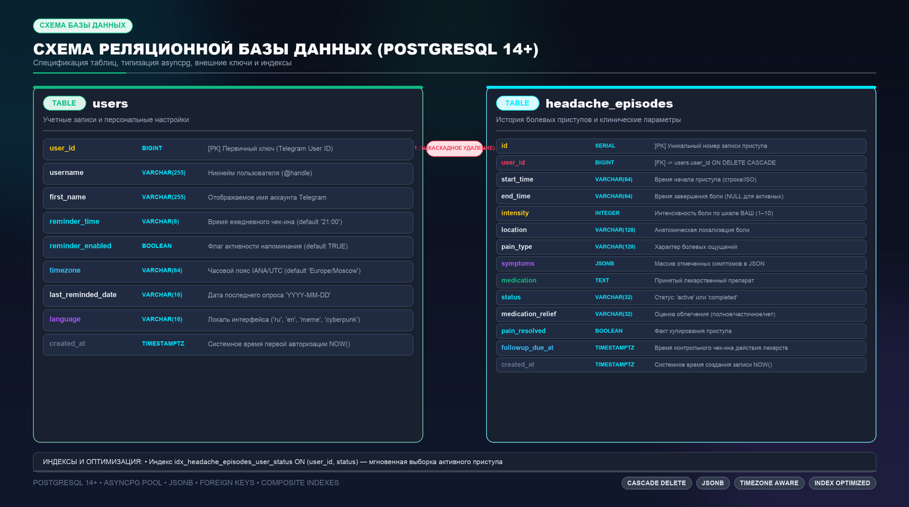

<div align="center">


# 🧠 Migrebot Analog
### Персональный Telegram-дневник приступов мигрени и головной боли

[](https://www.python.org/)
[](https://docs.aiogram.dev/)
[](https://www.postgresql.org/)
[](https://redis.io/)
[](https://www.reportlab.com/)
[-brightgreen?style=for-the-badge&logo=pytest&logoColor=white)](tests/test_flow.py)
[](LICENSE)

<p align="center">
  🇷🇺 <b>Русский</b> &nbsp;•&nbsp; <a href="README_en.md"><b>🇬🇧 English</b></a>
</p>

<p align="center">
  <b>Умный бот для структурированной фиксации симптомов, характера и интенсивности боли,<br>
  автоматического расчета длительности приступов и формирования клинических отчетов для невролога.</b>
</p>

<p align="center">
  <a href="#-основные-возможности">✨ Возможности</a> •
  <a href="#-архитектура-системы">📐 Архитектура</a> •
  <a href="#-интерфейс-и-сценарии-работы">🎮 Сценарии</a> •
  <a href="#-стек-технологий">🛠 Стек</a> •
  <a href="#-быстрый-старт">⚙️ Быстрый старт</a> •
  <a href="#-тестирование">🧪 Тестирование</a> •
  <a href="#-развертывание-на-сервере-systemd">🚀 Деплой</a> •
  <a href="#-база-данных">📋 База данных</a>
</p>

</div>

---

## 📐 Архитектура системы

Полностью асинхронная отказоустойчивая архитектура на базе микросервисного взаимодействия Python-сервиса, распределенного Redis FSM и СУБД PostgreSQL:

<div align="center">
  
</div>

<br>

| Компонент | Технология | Назначение |
| :--- | :--- | :--- |
| **Telegram Client** | Telegram API | Пользовательский интерфейс: инлайн-кнопки, интерактивные чекбоксы, Reply-меню |
| **Core Engine** | `aiogram 3.x` (Python) | Асинхронный роутинг сообщений, обработка коллбэков и навигация FSM |
| **Session Cache** | `Redis` (порт `6532`) | Изолированное хранение состояний диалога `DefaultKeyBuilder(with_bot_id=True)` |
| **Primary Database** | `PostgreSQL 14+` (`asyncpg`) | Постоянное хранение профилей пользователей и истории приступов (JSONB) |
| **Reporting Engine**| `ReportLab` + TTF Fonts | Генерация медицинских таблиц PDF (A4 Landscape) и UTF-8 BOM CSV |

---

## 🌟 Основные возможности

### 1. ⏱ Пошаговый FSM-опросник приступа
- **Время начала**: Быстрые пресеты (*Прямо сейчас, 30 минут назад, 1 час, 2 часа назад*) или ввод точного времени вручную.
- **Шкала боли (1–10)**: Интуитивная градация от едва ощутимой (1) до невыносимой (10).
- **Локализация**: Слева, справа, с обеих сторон, лоб и виски, затылок, диффузная боль.
- **Характер боли**: Пульсирующая, давящая/сжимающая, распирающая, колющая/прострелы, тупая/ноющая.
- **Мультиселект симптомов**: Интерактивные inline-чекбоксы с сохранением выбора в реальном времени (тошнота, рвота, светобоязнь, звукобоязнь, зрительная аура, головокружение, запахи).
- **Медикаменты**: Выбор фармакологической группы (триптаны, НПВП, комбинированные, анальгетики) либо указание своего препарата.

### 2. ⏹ Автоматический хронометраж длительности
- При стихании боли кнопка **«⏹ Завершить приступ»** фиксирует время окончания и рассчитывает суммарную продолжительность (например: `2 ч 4 мин`).

### 3. 📥 Клинический экспорт для врача-невролога
- 📄 **PDF-отчет (Landscape A4)**: Профессиональная медицинская таблица со сводными метриками пациента (средняя сила приступа, количество эпизодов). Поддерживает кириллицу, латиницу и CJK (японские иероглифы/катакану) благодаря шрифту `VL-Gothic`.
- 📊 **Таблица CSV (Excel)**: Экспорт с кодировкой UTF-8 BOM и разделителем `;` — открывается в Excel и Google Spreadsheets без искажений символов.

### 4. 📊 Мгновенная история
- Быстрый просмотр последних приступов в Telegram с наглядным отображением статусов (🟢 завершен / 🔴 активен) и ключевых параметров.

### 5. ⏰ Ежедневные персонализированные опросы
- **Регулярный чек-ин**: Каждый день в выбранное пользователем время бот отправляет интерактивный запрос: *«Болела ли голова сегодня?»*.
- **Быстрые действия**:
  - `🤕 Да, болела` — мгновенный переход к фиксации приступа в дневнике.
  - `👌 Нет, всё отлично` — сохранение бессимптомного дня в истории.
  - `⚙️ Настроить время` — изменение параметров опроса.
- **Выбор часового пояса (11 часовых зон РФ + мир)**:
  - Поддержка всех часовых поясов: от Калининграда (UTC+2) до Камчатки (UTC+12), а также европейских и американских зон.
  - Ручной ввод смещения (`UTC+5`, `+4`, `-5`) или IANA-идентификатора (`Asia/Almaty`, `Europe/Minsk`).
  - Отображение текущего местного времени пользователя прямо в интерфейсе.
- **Гибкая настройка расписания**: Быстрые пресеты (`09:00`, `14:00`, `19:00`, `21:00`, `22:00`, `23:00`) или ввод любого произвольного времени (`ЧЧ:ММ`), а также возможность временного отключения.
- **Фоновый планировщик**: Асинхронный воркер проверяет расписание каждую минуту с учетом индивидуального часового пояса каждого пользователя и защищает от повторных отправок в течение одного календарного дня.

---

## 🎮 Интерфейс и сценарии работы

Наглядный процесс прохождения пользователя по шагам фиксации приступа боли, сохранения в базу данных и выгрузки медицинских заключений:

<div align="center">
  
</div>

---

## ⌨️ Команды и навигация

| Команда | Кнопка меню | Назначение |
| :--- | :--- | :--- |
| `/start` | — | Персонализированное приветствие с именем/никнеймом и регистрация |
| `/log`, `/headache` | `🤕 Записать приступ` | Запуск пошагового FSM-диалога записи приступа |
| `/finish` | `⏹ Завершить приступ` | Закрытие активного приступа с фиксацией длительности |
| `/export` | `📥 Экспорт отчета` | Меню выгрузки медицинского отчета (PDF / CSV / Оба) |
| — | `📊 Мои приступы` | Экспресс-просмотр последних 5 записей из дневника |
| `/reminder`, `/settings` | `⏰ Напоминания` | Настройка времени ежедневного опроса самочувствия |
| `/help` | `ℹ️ Справка` | Справочное руководство по ведению дневника |
| `/cancel` | `❌ Отмена` | Прерывание текущего опроса и возврат в главное меню |

---

## 🛠 Стек технологий

- **Ядро**: Python 3.10+ / 3.13 (асинхронный цикл событий `asyncio`)
- **Telegram Bot Framework**: `aiogram 3.31`
- **FSM State Engine**: `redis.asyncio` + `RedisStorage`
- **База данных**: `PostgreSQL 14` + драйвер `asyncpg 0.31`
- **Документооборот**: `ReportLab 4.4` + шрифтовой стек `DejaVuSans` & `VL-Gothic`
- **Тестирование**: `unittest` (`IsolatedAsyncioTestCase` + мокирование `AsyncMock`)
- **Менеджер сервисов**: `systemd` (Linux daemon с `PYTHONUNBUFFERED=1`)

---

## 📂 Структура проекта

```text
migrebot_analog/
├── assets/
│   ├── fonts/             # TrueType шрифты (DejaVuSans, VL-Gothic для CJK/кириллицы)
│   └── images/            # Графические схемы, баннеры и диаграммы
├── db/
│   ├── __init__.py        # Экспорт методов БД
│   └── database.py        # Асинхронный пул PostgreSQL (asyncpg), миграции и CRUD
├── handlers/
│   ├── __init__.py        # Роутер хэндлеров
│   ├── startHandler.py    # Команды /start, /help, меню истории приступов
│   ├── headache.py        # FSM-опросник фиксации и завершения приступа
│   ├── reminderHandler.py # Настройка и обработка ежедневных опросов
│   └── exportHandler.py   # Генерация и отправка отчетов (/export)
├── keyboards/
│   ├── __init__.py
│   ├── main_menu.py       # Постоянная клавиатура быстрого доступа (Reply)
│   ├── reminder_kb.py     # Инлайн-кнопки настроек и ежедневного чек-ина
│   └── headache_kb.py     # Инлайн-клавиатуры опросника, навигация и коллбэки
├── services/
│   ├── __init__.py
│   ├── reminder_service.py # Фоновый планировщик ежедневных опросов (MSK)
│   └── export_service.py  # Сборка медицинского PDF и таблицы CSV с очисткой эмодзи
├── states/
│   ├── __init__.py
│   ├── reminder.py        # FSM-состояния настроек напоминаний (ReminderSG)
│   └── headache.py        # FSM-состояния (HeadacheLogSG)
├── tests/
│   └── test_flow.py       # Набор юнит-тестов (клавиатуры, FSM, БД, экспорт CJK, напоминания)
├── .env                   # Конфигурация подключения (токен, Redis, Postgres)
├── .gitignore             # Игнорируемые файлы окружения
├── requirements.txt       # Зависимости Python
├── main.py                # Точка входа приложения
└── README.md              # Документация проекта
```

---

## ⚙️ Быстрый старт

### 1. Клонирование и установка зависимостей
```bash
git clone https://github.com/xanax01d/migrebot_analog.git
cd migrebot_analog

python3 -m venv venv
source venv/bin/activate
pip install --upgrade pip
pip install -r requirements.txt
```

### 2. Конфигурация (`.env`)
Создайте файл `.env` в корне проекта:

```dotenv
# Telegram Bot Token (получить у @BotFather)
TOKEN="your_telegram_bot_token"

# Настройки Redis (FSM)
RedisIP="127.0.0.1"
RedisPort=6532
RedisPassword="your_redis_password"

# Настройки PostgreSQL
POSTGRES_HOST=127.0.0.1
POSTGRES_PORT=5432
POSTGRES_USER=migrebot
POSTGRES_PASSWORD=your_pg_password
POSTGRES_DB=migrebot

# Сетевые параметры
POSTGRES_SSL=disable
POSTGRES_TIMEOUT=10.0
POSTGRES_COMMAND_TIMEOUT=15.0
```

### 3. Запуск бота
```bash
python3 main.py
```

---

## 🧪 Тестирование

Проект покрыт набором асинхронных юнит-тестов (`unittest.IsolatedAsyncioTestCase` с изоляцией моками `AsyncMock`), проверяющих целостность бизнес-логики, FSM-переходов, навигации, базы данных и генерации отчетов:

```bash
python3 -m unittest tests/test_flow.py -v
```

### Структура тест-сьюта (17 тестов):

| Тест | Категория | Проверяемая функциональность |
| :--- | :--- | :--- |
| `test_nav_callbacks_packing` | 🧭 Навигация | Корректная упаковка callback-данных `hdn:back` («Назад») и `hdn:cancel` («Отмена») |
| `test_navigation_buttons_presence_in_keyboards` | 🧭 Навигация | Наличие кнопок «Назад» и «Отмена» во всех 8 клавиатурах опросника (включая ручной ввод времени) |
| `test_navigation_back_fsm_transitions` | 🧭 Навигация | Корректный пошаговый возврат назад по всем состояниям FSM (`confirm` ➔ `medication` ➔ `symptoms` ➔ `pain_type` ➔ `location` ➔ `intensity` ➔ `start_time`, `custom_start_time` ➔ `start_time`) |
| `test_cancel_flow_clears_state` | 🧭 Навигация | Гарантированный сброс FSM-состояния (`state.clear()`) при нажатии на кнопку «Отмена» и отправке команды `/cancel` |
| `test_callback_packing` | 🔘 Клавиатуры | Корректность префиксов и сериализации коллбэков всех шагов (время, интенсивность, локация, характер боли, симптомы, медикаменты, экспорт) |
| `test_keyboards_structure` | 🔘 Клавиатуры | Валидация сетки кнопок, текстов и коллбэк-данных всех инлайн-клавиатур |
| `test_reminder_keyboards_and_callbacks` | ⏰ Напоминания | Формирование клавиатур настроек, чек-ина, таймзон и сериализация `rem\|...`, `rem_p\|...` |
| `test_timezone_resolution_and_formatting` | ⏰ Часовые пояса | Парсинг и валидация часовых поясов (IANA, пресеты городов, смещения UTC±X), форматирование времени |
| `test_reminder_custom_time_validation` | ⏰ Напоминания | Валидация регулярным выражением произвольного ввода времени (`ЧЧ:ММ`, от 00:00 до 23:59) |
| `test_reminder_db_methods_mocked` | ⏰ Напоминания | Выборка пользователей, обновление времени/статуса/пояса и фиксация даты отправки опроса |
| `test_reminder_prompt_callbacks` | ⏰ Напоминания | Обработка реакций на чек-ин («Да, болела» ➔ старт FSM, «Нет, всё отлично» ➔ благодарность) |
| `test_reminder_scheduler_tick` | ⏰ Напоминания | Изолированное выполнение тика фонового планировщика с учетом часового пояса пользователя |
| `test_csv_and_pdf_generation` | 📄 Экспорт | Сборка медицинского PDF-отчета (ReportLab Landscape A4) и CSV таблицы с кодировкой UTF-8 BOM без ошибок |
| `test_cjk_and_nickname_export` | 📄 Экспорт | Поддержка кириллицы, латиницы, CJK-иероглифов и никнеймов шрифтовым стеком `VL-Gothic` |
| `test_redis_fsm_storage_config` | 🗄 Хранилища | Изоляция ключей состояний FSM в Redis (`DefaultKeyBuilder(with_bot_id=True)`) |
| `test_postgres_dsn_generation` | 🗄 База данных | Формирование строки DSN подключения к PostgreSQL с параметрами безопасности и таймаутов |
| `test_postgres_db_lifecycle_mocked` | 🗄 База данных | Жизненный цикл CRUD: создание профиля пользователя, открытие приступа, выборка истории и закрытие приступа |

---

## 🚀 Развертывание на сервере (Systemd)

1. Клонируйте проект в каталог `/opt/migrebot`:
   ```bash
   mkdir -p /opt/migrebot
   cd /opt/migrebot
   python3 -m venv venv
   ./venv/bin/pip install -r requirements.txt
   ```

2. Создайте конфигурацию службы `/etc/systemd/system/migrebot.service`:
   ```ini
   [Unit]
   Description=Migrebot Telegram Bot
   After=network.target redis-server.service postgresql.service
   Wants=redis-server.service postgresql.service

   [Service]
   Type=simple
   User=root
   WorkingDirectory=/opt/migrebot
   Environment=PYTHONUNBUFFERED=1
   ExecStart=/opt/migrebot/venv/bin/python3 main.py
   Restart=always
   RestartSec=5

   [Install]
   WantedBy=multi-user.target
   ```

3. Запустите и добавьте в автозагрузку:
   ```bash
   systemctl daemon-reload
   systemctl enable migrebot.service
   systemctl start migrebot.service
   ```

4. Мониторинг работы:
   ```bash
   systemctl status migrebot.service
   journalctl -u migrebot.service -f
   ```

---

## 📋 База данных

Схема реляционной структуры PostgreSQL с внешними ключами и JSONB-полями:

<div align="center">
  
</div>

<br>

Таблицы и индексы создаются автоматически при старте бота через пул `asyncpg`:

### `users`
| Колонка | Тип | Описание |
| :--- | :--- | :--- |
| `user_id` | `BIGINT PRIMARY KEY` | Уникальный идентификатор пользователя Telegram |
| `username` | `VARCHAR(255)` | Никнейм (@username) |
| `first_name` | `VARCHAR(255)` | Имя профиля Telegram |
| `reminder_time` | `VARCHAR(8)` | Время ежедневного опроса (по умолчанию `21:00`) |
| `reminder_enabled` | `BOOLEAN` | Флаг активности напоминаний (`true`/`false`) |
| `timezone` | `VARCHAR(64)` | Часовой пояс пользователя (`Europe/Moscow`) |
| `last_reminded_date` | `VARCHAR(16)` | Дата последней отправки опроса (`YYYY-MM-DD`) |
| `created_at` | `TIMESTAMPTZ` | Время первой авторизации |

### `headache_episodes`
| Колонка | Тип | Описание |
| :--- | :--- | :--- |
| `id` | `BIGSERIAL PRIMARY KEY` | Порядковый номер приступа |
| `user_id` | `BIGINT REFERENCES users` | Владелец записи |
| `start_time` | `VARCHAR(64)` | Время начала боли |
| `end_time` | `VARCHAR(64)` | Время окончания боли (null для активных) |
| `intensity` | `SMALLINT` | Интенсивность боли по шкале от 1 до 10 |
| `location` | `VARCHAR(64)` | Локализация боли |
| `pain_type` | `VARCHAR(64)` | Характер болевых ощущений |
| `symptoms` | `JSONB` | Список отмеченных симптомов в формате JSON |
| `medication` | `VARCHAR(255)` | Принятый лекарственный препарат |
| `status` | `VARCHAR(32)` | Статус: `active` или `completed` |
| `created_at` | `TIMESTAMPTZ` | Системное время создания записи |

*Индекс `idx_headache_episodes_user_status` на `(user_id, status)` обеспечивает мгновенный поиск активного приступа.*

---

<div align="center">
  <sub>Разработано для заботы о здоровье и эффективного диалога с врачом-неврологом.</sub>
</div>
