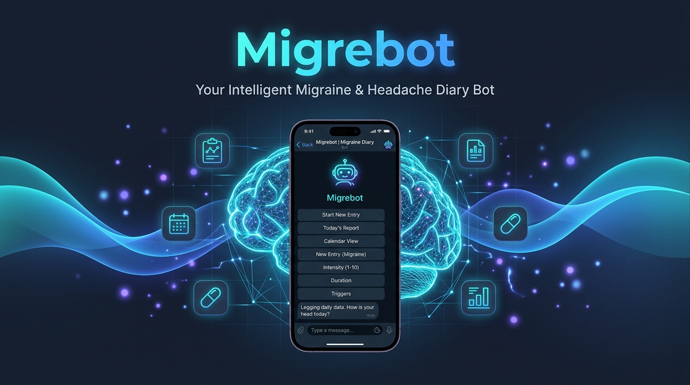
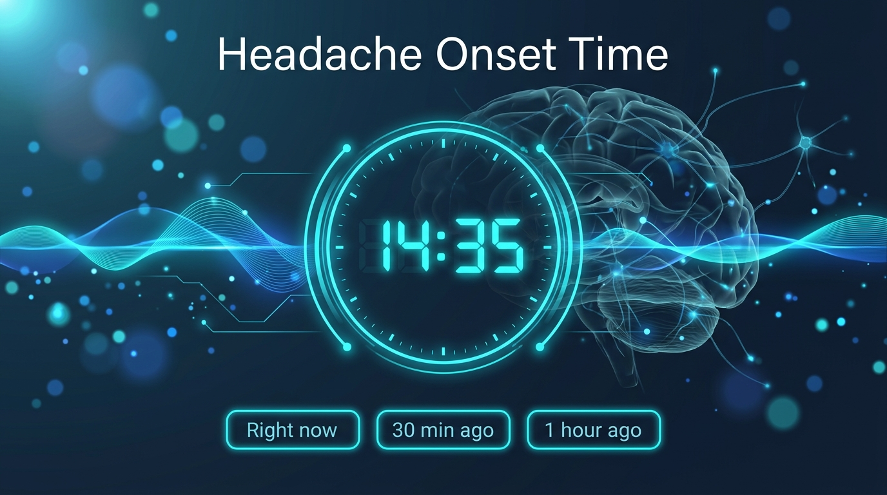
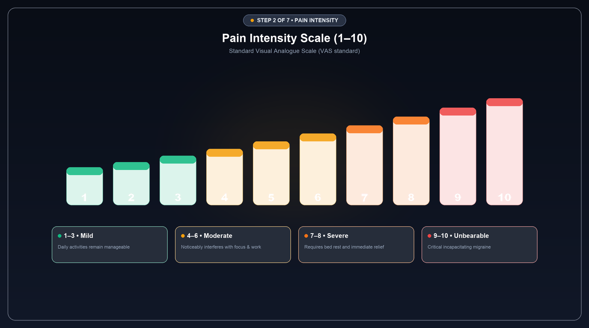
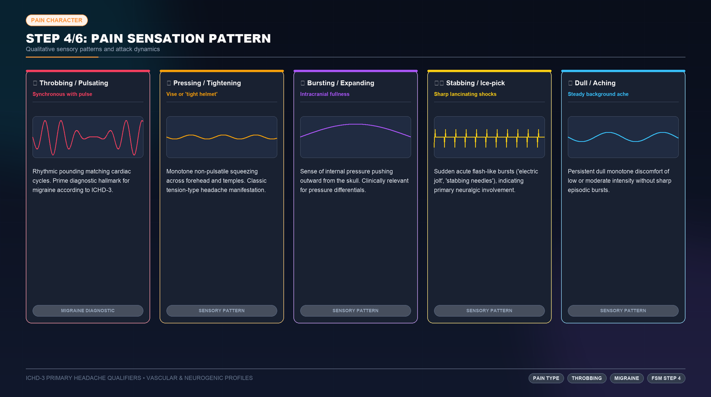
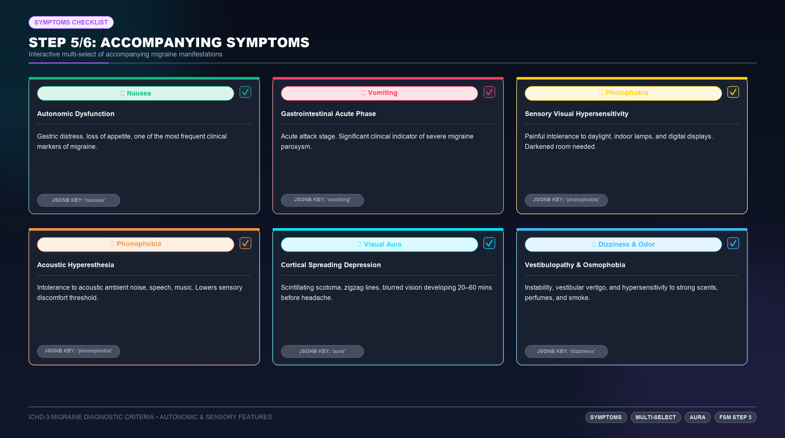
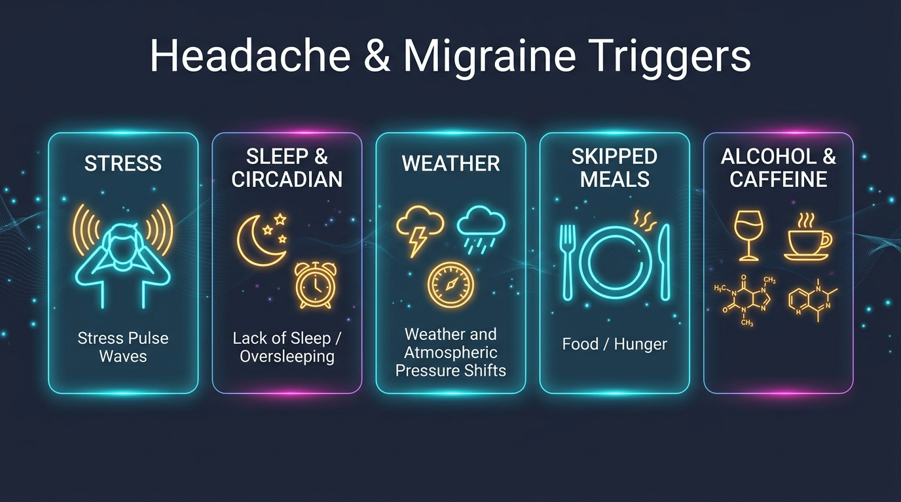
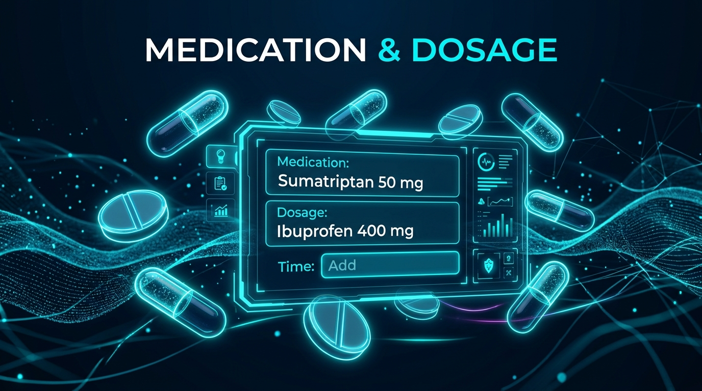
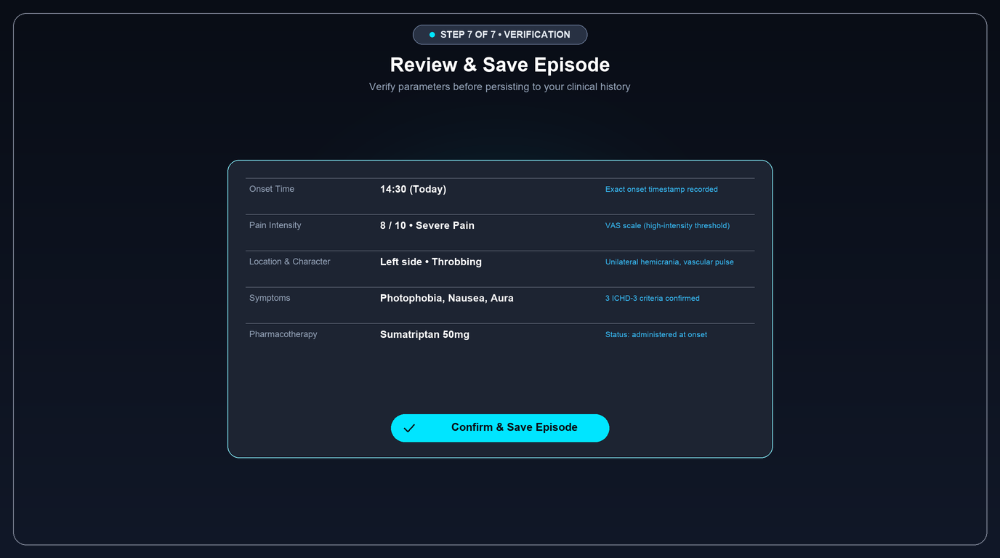
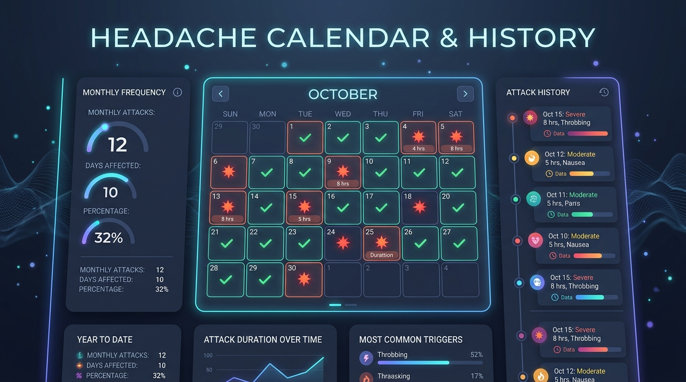

<div align="center">



# 🧠 Migrebot Analog
### Personal Telegram Headache & Migraine Diary Bot

[](https://www.rust-lang.org/)
[](https://teloxide.rs/)
[](https://tokio.rs/)
[](https://www.postgresql.org/)
[](https://github.com/launchbadge/sqlx)
[](#4-🌐-multilingual-support-5-locales)
[](#3-🩺-automated-follow-up--medication-efficacy-tracking)
[](https://telegram.org/)
[](LICENSE)

<p align="center">
  <a href="README.md"><b>🇷🇺 Русский</b></a> &nbsp;•&nbsp; 🇬🇧 <b>English</b>
</p>

<p align="center">
  <b>Smart Telegram bot for structured tracking of headache symptoms, character, and intensity,<br>
  dynamic step visual cards, automated pain relief follow-ups, and clinical neurologist report generation.</b>
</p>

<p align="center">
  <a href="#-key-features">✨ Features</a> •
  <a href="#-system-architecture">📐 Architecture</a> •
  <a href="#-user-workflow--scenarios">🎮 Workflows</a> •
  <a href="#-tech-stack">🛠 Tech Stack</a> •
  <a href="#-quick-start">⚙️ Quick Start</a> •
  <a href="#-testing">🧪 Testing</a> •
  <a href="#-server-deployment-systemd">🚀 Deployment</a> •
  <a href="#-database-schema">📋 Database</a>
</p>

</div>

---

## 📐 System Architecture

Fully asynchronous, resilient microservice-like architecture integrating Python, distributed Redis FSM, PostgreSQL, and background task workers:

<div align="center">
  
</div>

<br>

| Component | Technology | Role |
| :--- | :--- | :--- |
| **Telegram Client** | Telegram API | User interface: inline buttons, checkboxes, reply menus, dynamic step cards via `edit_media` |
| **Core Engine** | `aiogram 3.x` (Python) | Async message dispatching, callback handlers, multilingual routing, and FSM navigation |
| **Session Cache** | `Redis` (port `6532`) | Isolated dialog state storage with `DefaultKeyBuilder(with_bot_id=True)` |
| **Primary Database** | `PostgreSQL 14+` (`asyncpg`) | Persistent storage for user profiles, languages, headache episodes (JSONB), and follow-up metrics |
| **Follow-up Scheduler**| `asyncio` Background Task | 2-hour pain resolution check and medication efficacy assessment scheduler |
| **Reminder Scheduler** | `asyncio` Background Task | Daily wellness check-in scheduler with per-user timezone resolution |
| **Reporting Engine**| `ReportLab` + TTF Fonts | Medical PDF generation (A4 Landscape) and UTF-8 BOM CSV exports |

---

## 🌟 Key Features

### 1. ⏱ Step-by-Step FSM Questionnaire with Dynamic Card Transitions
- **Smooth `edit_media` Transitions**: Across questionnaire stages, the bot smoothly updates high-tech visual cards (`start_time.png` ➔ `pain_scale.png` ➔ `location.png` ➔ `pain_type.png` ➔ `symptoms.png` ➔ `triggers.png` ➔ `medication.png` ➔ `confirm.png` ➔ `saved.png`) in the chosen language (RU/EN).
- **Start Time**: Quick presets (*Right now, 30 min ago, 1 hour ago, 2 hours ago*) or manual custom time entry (`HH:MM` or `YYYY-MM-DD HH:MM`).
- **Pain Scale (1–10)**: Clear intensity rating from mild (1) to unbearable (10).
- **Localization**: Left side, right side, both sides, forehead and temples, back of head, diffuse pain.
- **Pain Character**: Throbbing, pressing/tightening, bursting, stabbing/shooting, dull/aching.
- **Multi-Select Symptoms**: Interactive inline checkboxes with instant live state updates (nausea, vomiting, photophobia, phonophobia, visual aura, dizziness, odor sensitivity).
- **Headache Triggers Tracking**: Comprehensive multi-select toggle questionnaire:
  - *Stress / Fatigue*
  - *Lack of sleep*
  - *Oversleeping / Too much sleep*
  - *Weather / Pressure changes*
  - *Hunger / Skipped meals*
  - *Alcohol*
  - *Caffeine*
  - *Sensory stimuli (noise, bright light, stuffiness)*
  - *Physical exertion*
  - *No clear trigger*
  - **Custom trigger**: `✍️ Custom trigger` button or direct free-text message submission.
- **Medication Taken & Efficacy**: Category selection (triptans, NSAIDs, analgesics, paracetamol), intake delay calculation, and interactive relief status assessment.

### 2. ⏹ Automatic Duration Chronometry
- When pain subsides, tapping **«⏹ Finish episode»** (or command `/finish`) records the end timestamp and calculates total duration (e.g. `2h 13m`).

### 3. 🩺 Automated Follow-up & Medication Efficacy Tracking
- **2-Hour Automated Check**: The background scheduler detects unresolved episodes and prompts the user after 2 hours: *«Has the headache stopped?»*.
- **Resolution Timing**: Quick responses (`✅ Yes, pain passed`, `❌ Still hurting`) with intuitive timing presets (*just now, 15m ago, 30m ago, 1h ago*).
- **Medication Relief Rating**: If medicine was taken, the bot asks for clinical efficacy feedback:
  - `💊 Helped well` (`helped`)
  - `⚠️ Partial relief` (`partial`)
  - `❌ Did not help` (`not_helped`)
- Stored directly in the database and included in doctor report exports.

### 4. 🌐 Multilingual Support (4 Locales)
- Instant language switching via `/language` command or `🌐 Language` button:
  - 🇷🇺 **Russian (`ru`)**: Clinical medical terminology.
  - 🇬🇧 **English (`en`)**: International ICHD-3 medical terminology.
  - 🎭 **Meme Slang (`meme`)**: Viral internet humor & gamer slang.
  - 🦾 **Cyberpunk 2077 (`cyberpunk`)**: Night City immersion (biomonitors, cyberware, neurochips, Trauma Team, Kiroshi optics, neuroblockers).
- Fully localized keyboards, templates, history cards, and prompts without raw code leaks.

### 5. 📥 Clinical Export for Neurologists
- Displays dedicated export artwork (`export.png`).
- 📄 **PDF Medical Report (Landscape A4)**: Clinical table with patient metadata, episode history, triggers list, relief ratings, and aggregate statistics (average intensity, episode count). Full CJK and Cyrillic support via embedded `VL-Gothic` TrueType font.
- 📊 **CSV Table (Excel)**: UTF-8 BOM encoded spreadsheet with semicolon (`;`) delimiters — opens seamlessly in Excel and Google Sheets without encoding glitches.

### 6. 📅 Interactive Episode Calendar (`📊 My episodes` / `/history`)
- **Monthly Grid View**: Full calendar grid displayed inside Telegram with color-coded daily health indicators:
  - 🔴 `{day}` — day with a recorded headache episode;
  - 🟢 `{day}` — pain-free day (asymptomatic days from 1st of month up to today);
  - `{day}` — upcoming days (protected against inadvertent taps with a friendly notice).
- **Month Navigation**: Cycle backward/forward through months (`◀️` / `▶️`) and quick return to the current month (`[ 📅 Month Year ]`).
- **Day Details Card**: Clicking any day reveals the comprehensive episode card (onset, duration, intensity, triggers, medication, relief outcome) or confirms a healthy day (*«No headache recorded on this day 🎉»*), with an instant `◀️ Back to calendar` button.

### 7. ⏰ Daily Personalized Check-ins
- **Routine Inquiries**: Daily automated check-in prompt at user-configured time: *«Did you have a headache today?»*.
- **Quick Action Handlers**:
  - `🤕 Yes, had pain` — launches step-by-step episode logging immediately with `start_time.png`.
  - `👌 No, feeling great` — saves asymptomatic day record in diary.
  - `⚙️ Adjust time` — directly open reminder settings.
- **Timezone Customization (11 Russian Zones + Worldwide)**:
  - Supports all timezones from Kaliningrad (UTC+2) to Kamchatka (UTC+12), London (UTC+0), Berlin (UTC+1), New York (UTC-5), etc.
  - Manual entry via standard UTC offsets (`UTC+5`, `+4`, `-5`) or IANA identifiers (`Asia/Almaty`, `Europe/Minsk`).
  - Displays user's current local time directly in the configuration menu.
- **Flexible Timing & Presets**: Select from common presets (`09:00`, `14:00`, `19:00`, `21:00`, `22:00`, `23:00`) or enter any custom `HH:MM` time.

### 8. ⚡️ High Performance & Media Caching
- **Telegram CDN `file_id` Caching**: All 28 step graphics and banners are pre-cached on Telegram CDN servers. Instead of repeatedly uploading 150 KB files via `multipart/form-data`, the bot passes a lightweight `file_id` string (~70 bytes in JSON), achieving 15–45x faster step transitions.
- **MD5 Hash Invalidation**: Detects on-disk image modifications automatically, clearing stale `file_id` entries and re-uploading fresh assets seamlessly.
- **Per-Locale Namespace Isolation**: Prevents cross-language collisions between RU and EN image variants.
- **Sub-100ms Latency**: Total questionnaire step update handling latency reduced to **~50 ms**.

---

## 🎮 User Workflow & Scenarios

Interactive flow from initial recording to automated follow-up, persistent storage, and medical report generation:

<div align="center">
  
</div>

<br>

### 🖼 Bot Screen & Step Card Gallery

<div align="center">
<table>
  <tr>
    <td align="center" width="50%">
      <b>⏱ Step 1: Headache Onset Time</b><br>
      
    </td>
    <td align="center" width="50%">
      <b>📊 Step 2: Pain Intensity Scale (1–10)</b><br>
      
    </td>
  </tr>
  <tr>
    <td align="center" width="50%">
      <b>🎯 Step 3: Pain Localization</b><br>
      
    </td>
    <td align="center" width="50%">
      <b>⚡️ Step 4: Pain Type & Character</b><br>
      
    </td>
  </tr>
  <tr>
    <td align="center" width="50%">
      <b>🩺 Step 5: Accompanying Symptoms & Aura</b><br>
      
    </td>
    <td align="center" width="50%">
      <b>🌪 Step 6: Provoking Triggers</b><br>
      
    </td>
  </tr>
  <tr>
    <td align="center" width="50%">
      <b>💊 Step 7: Medication & Dosage</b><br>
      
    </td>
    <td align="center" width="50%">
      <b>🛡 Step 8: Summary & Confirmation</b><br>
      
    </td>
  </tr>
  <tr>
    <td align="center" width="50%">
      <b>📅 Episode Calendar & History</b><br>
      
    </td>
    <td align="center" width="50%">
      <b>📥 Clinical Report Export (PDF & CSV)</b><br>
      
    </td>
  </tr>
</table>
</div>

---

## ⌨️ Commands & Navigation

| Command | Menu Button | Description |
| :--- | :--- | :--- |
| `/start` | — | Personalized greeting with user name/nickname and auto-registration |
| `/log`, `/headache` | `🤕 Record episode` | Initiates the step-by-step FSM questionnaire with dynamic cards |
| `/finish` | `⏹ Finish episode` | Closes the active episode and computes elapsed time |
| `/status` | — | Check active episode status and record medication efficacy |
| `/export` | `📥 Export report` | Report export menu (PDF / CSV / Both) |
| `/history` | `📊 My episodes` | Interactive monthly calendar of episodes (🔴 headache / 🟢 pain-free) with day inspection |
| `/reminder`, `/settings` | `⏰ Reminders` | Daily wellness check-in schedule & timezone settings |
| `/language` | `🌐 Language` | Switch interface locale (RU, EN, Meme, Cyberpunk) |
| `/help` | `ℹ️ Help` | Comprehensive diary guide and pain scale documentation |
| `/cancel` | `❌ Cancel` | Aborts the active survey and returns to the main menu |

---

## 🛠 Tech Stack

- **Runtime**: Python 3.10+ / 3.13 (asynchronous event loop with `asyncio`)
- **Telegram Bot Framework**: `aiogram 3.31`
- **FSM State Engine**: `redis.asyncio` + `RedisStorage`
- **Database**: `PostgreSQL 14+` + high-performance `asyncpg 0.31` driver
- **Background Workers**: Async schedulers for reminders and follow-up
- **Reporting & Typography**: `ReportLab 4.4` with `DejaVuSans` & `VL-Gothic` TrueType fonts
- **Asset Rendering**: `Pillow 11` (Lanczos 2x supersampling, 1376×768)
- **Test Suite**: `unittest` (`IsolatedAsyncioTestCase` with `AsyncMock`)
- **Service Supervision**: `systemd` (Linux service with `PYTHONUNBUFFERED=1`)

---

## 📂 Project Structure

```text
migrebot_analog/
├── assets/
│   ├── fonts/             # TrueType fonts (DejaVuSans, VL-Gothic for CJK/Cyrillic)
│   ├── images/            # High-tech medical illustrations & step cards (30 files)
│   │   ├── ru/            # Russian assets (hero, diagrams, history, export, steps)
│   │   └── en/            # English assets (hero, diagrams, history, export, steps)
│   └── image_cache.json   # Persistent registry of Telegram photo file_ids & MD5 hashes
├── db/
│   ├── __init__.py        # Database interface exports
│   └── database.py        # Asynchronous PostgreSQL pool (asyncpg), DDL, monthly queries & CRUD
├── handlers/
│   ├── __init__.py        # Handlers root router
│   ├── startHandler.py    # /start, /help, and interactive history calendar (history.png)
│   ├── headache.py        # FSM logging flow with dynamic step transitions (edit_media) & triggers
│   ├── followupHandler.py # Interactive pain relief check & medication rating
│   ├── languageHandler.py # Language switching interface (/language)
│   ├── reminderHandler.py # Daily check-in scheduling and timezone configuration
│   └── exportHandler.py   # PDF and CSV export dispatcher (export.png)
├── keyboards/
│   ├── __init__.py
│   ├── main_menu.py       # Persistent bottom reply keyboard
│   ├── reminder_kb.py     # Inline keyboards for reminders and check-in prompt
│   ├── calendar_kb.py     # Interactive monthly calendar grid with status indicators
│   └── headache_kb.py     # Inline keyboards, triggers, callbacks, follow-up, and navigation
├── locales/
│   ├── __init__.py        # Localization dispatcher and dictionary resolvers
│   ├── ru.py              # Russian (clinical)
│   ├── en.py              # English (medical)
│   ├── meme.py            # Meme slang (Runet)
│   └── cyberpunk.py       # Cyberpunk 2077 (Night City)
├── services/
│   ├── __init__.py
│   ├── media_cache.py     # Telegram CDN file_id caching, edit_media & MD5 hashing
│   ├── followup_service.py # Background scheduler worker for 2-hour pain checks
│   ├── reminder_service.py # Background scheduler worker for daily reminders
│   └── export_service.py  # Medical PDF and CSV report builders with emoji cleaning
├── states/
│   ├── __init__.py
│   ├── reminder.py        # FSM states for reminder settings (ReminderSG)
│   └── headache.py        # FSM states for questionnaire (HeadacheLogSG)
├── tests/
│   └── test_flow.py       # Comprehensive unit tests (29 tests: FSM, DB, i18n, calendar, triggers)
├── .env                   # Environment secrets (bot token, Redis, Postgres)
├── .gitignore             # Git ignored files and directories
├── requirements.txt       # Python dependencies
├── main.py                # Application entry point and polling dispatcher
├── README.md              # Russian documentation
├── README_ru.md           # Russian documentation
└── README_en.md           # English documentation
```

---

## ⚙️ Quick Start

### 1. Clone & Setup Virtual Environment
```bash
git clone https://github.com/xanax01d/migrebot_analog.git
cd migrebot_analog

python3 -m venv venv
source venv/bin/activate
pip install --upgrade pip
pip install -r requirements.txt
```

### 2. Environment Configuration (`.env`)
Create a `.env` file in the project root:

```dotenv
# Telegram Bot Token (obtain from @BotFather)
TOKEN="your_telegram_bot_token"

# Redis Configuration (FSM)
RedisIP="127.0.0.1"
RedisPort=6532
RedisPassword="your_redis_password"

# PostgreSQL Configuration
POSTGRES_HOST=127.0.0.1
POSTGRES_PORT=5432
POSTGRES_USER=migrebot
POSTGRES_PASSWORD=your_pg_password
POSTGRES_DB=migrebot

# Network & Timeout Tuning
POSTGRES_SSL=disable
POSTGRES_TIMEOUT=10.0
POSTGRES_COMMAND_TIMEOUT=15.0
```

### 3. Start the Bot
```bash
python3 main.py
```

---

## 🧪 Testing

The repository contains a full asynchronous unit test suite (`unittest.IsolatedAsyncioTestCase` with `AsyncMock` isolation) verifying the integrity of business logic, FSM transitions, navigation, database persistence, i18n localization, and export generation:

```bash
python3 -m unittest discover -s tests -v
```

### Test Suite Structure (29 Tests):

| Test | Category | Verified Functionality |
| :--- | :--- | :--- |
| `test_nav_callbacks_packing` | 🧭 Navigation | Callback data packing for `hdn:back` ("Back") and `hdn:cancel` ("Cancel") |
| `test_navigation_buttons_presence_in_keyboards` | 🧭 Navigation | Verification of "Back" and "Cancel" buttons across all questionnaire keyboards (including triggers) |
| `test_navigation_back_fsm_transitions` | 🧭 Navigation | Step-by-step backward FSM state transitions (`confirm` ➔ `medication` ➔ `triggers` ➔ `symptoms` ➔ `pain_type` ➔ `location` ➔ `intensity` ➔ `start_time`) |
| `test_cancel_flow_clears_state` | 🧭 Navigation | Reliable FSM state clearing (`state.clear()`) on cancel button click and `/cancel` text command |
| `test_callback_packing` | 🔘 Keyboards | Correct prefixes and serialization of callbacks for all questionnaire steps (time, intensity, location, pain type, symptoms, triggers, medication, export) |
| `test_keyboards_structure` | 🔘 Keyboards | Validation of button layouts, captions, and callback payloads across all 4 supported languages |
| `test_triggers_flow_and_summary` | ⚡️ Triggers | Triggers multi-selection (stress, sleep, oversleep), clearing, custom text entry, summary inclusion |
| `test_calendar_history_flow_and_callbacks` | 📅 Calendar | Interactive month grid rendering, 🔴/🟢 day badges, `◀️`/`▶️` navigation, day detail and healthy day cards |
| `test_database_calendar_methods` | 🗄 Database | Month range query (`get_episodes_for_month`), date query (`get_episodes_for_date`), and table truncate |
| `test_reminder_keyboards_and_callbacks` | ⏰ Reminders | Keyboard builder verification, callback serialization with `rem\|...` and `rem_p\|...` prefixes |
| `test_timezone_resolution_and_formatting` | ⏰ Timezones | Parsing and validation of timezone identifiers (IANA, city presets, UTC±X offsets), local time formatting |
| `test_reminder_custom_time_validation` | ⏰ Reminders | Regex validation for arbitrary custom `HH:MM` time entries (00:00 to 23:59) |
| `test_reminder_db_methods_mocked` | ⏰ Reminders | Querying due users, updating reminder schedule/status/timezone, and logging dispatch dates |
| `test_reminder_prompt_callbacks` | ⏰ Reminders | Responses to daily inquiries ("Had pain" ➔ launch FSM with `start_time.png`, "No pain" ➔ save healthy day) |
| `test_reminder_scheduler_tick` | ⏰ Reminders | Unit execution of reminder background scheduler tick with per-user timezone support |
| `test_medication_relief_flow_branching` | 💊 Medication | Questionnaire branching: prompts for relief feedback ("Did it help?") when medication is specified, skips straight to confirmation if none |
| `test_medication_time_and_relief_calculation` | 💊 Medication | Pain resolution calculation, medication intake delay, episode duration calculation, and closing episode as `completed` |
| `test_followup_flow_and_medication_relief` | 🩺 Follow-up | Full lifecycle: pain resolution check, time of relief selection, and medication efficacy rating (`helped`, `partial`, `not_helped`) |
| `test_followup_scheduler_worker` | 🩺 Follow-up | Background scheduler worker for 2-hour checks and `followup_sent` state tracking |
| `test_i18n_locales_and_mappings` | 🌐 Localization | Completeness of dictionaries across all 4 locales (RU, EN, Meme, Cyberpunk): symptoms, triggers, locations, intensity, fallback |
| `test_format_episode_card_no_raw_vomiting` | 🌐 Localization | Zero technical code leakage in formatted episode cards across all languages |
| `test_language_handler_and_switching` | 🌐 Localization | `/language` command, language callback processing, DB storage, and prompt updating |
| `test_media_cache_functions` | ⚡️ Media Cache | Permanent `file_id` storage & retrieval, fallback to `FSInputFile`, MD5 hash invalidation, and locale isolation |
| `test_localized_assets` | 🎨 Media Assets | Verification of existence and dimensions (1376×768) of all 30 assets in RU and EN folders |
| `test_csv_and_pdf_generation` | 📄 Export | Generation of clinical PDF reports (ReportLab Landscape A4) and UTF-8 BOM CSV tables with triggers column |
| `test_cjk_and_nickname_export` | 📄 Export | Support for Cyrillic, Latin, CJK characters, and usernames via the `VL-Gothic` font stack |
| `test_redis_fsm_storage_config` | 🗄 Storage | Key namespace isolation for FSM states in Redis (`DefaultKeyBuilder(with_bot_id=True)`) |
| `test_postgres_dsn_generation` | 🗄 Database | Proper PostgreSQL DSN connection string generation with timeout and SSL settings |
| `test_postgres_db_lifecycle_mocked` | 🗄 Database | CRUD lifecycle: user profile registration, episode creation, history retrieval, and episode resolution |

---

## 🚀 Server Deployment (Systemd)

1. Clone project to `/opt/migrebot`:
   ```bash
   mkdir -p /opt/migrebot
   cd /opt/migrebot
   python3 -m venv venv
   ./venv/bin/pip install -r requirements.txt
   ```

2. Create service unit file `/etc/systemd/system/migrebot.service`:
   ```ini
   [Unit]
   Description=Migrebot Telegram Bot
   After=network.target redis-server.service postgresql.service
   Wants=redis-server.service postgresql.service

   [Service]
   Type=simple
   User=root
   WorkingDirectory=/opt/migrebot
   Environment=PYTHONUNBUFFERED=1
   ExecStart=/opt/migrebot/venv/bin/python3 main.py
   Restart=always
   RestartSec=5

   [Install]
   WantedBy=multi-user.target
   ```

3. Enable and start the service:
   ```bash
   systemctl daemon-reload
   systemctl enable migrebot.service
   systemctl start migrebot.service
   ```

4. Monitor status and live logs:
   ```bash
   systemctl status migrebot.service
   journalctl -u migrebot.service -f
   ```

---

## 📋 Database Schema

Relational structure in PostgreSQL with foreign keys, JSONB fields, and index optimization:

<div align="center">
  
</div>

<br>

Tables and indexes are automatically initialized on startup via `asyncpg`:

### `users`
| Column | Type | Description |
| :--- | :--- | :--- |
| `user_id` | `BIGINT PRIMARY KEY` | Unique Telegram user ID |
| `username` | `VARCHAR(255)` | Telegram username (@handle) |
| `first_name` | `VARCHAR(255)` | Profile first name |
| `language` | `VARCHAR(16) DEFAULT 'ru'` | Selected interface language (`ru`, `en`, `meme`, `cyberpunk`) |
| `reminder_time` | `VARCHAR(8)` | Daily check-in time (defaults to `21:00`) |
| `reminder_enabled` | `BOOLEAN` | Check-in activation flag (`true`/`false`) |
| `timezone` | `VARCHAR(64)` | User timezone string (`Europe/Moscow`) |
| `last_reminded_date` | `VARCHAR(16)` | Last reminder dispatch date (`YYYY-MM-DD`) |
| `created_at` | `TIMESTAMPTZ` | Timestamp of first interaction |

### `headache_episodes`
| Column | Type | Description |
| :--- | :--- | :--- |
| `id` | `BIGSERIAL PRIMARY KEY` | Episode auto-incrementing ID |
| `user_id` | `BIGINT REFERENCES users` | Owner reference |
| `start_time` | `VARCHAR(64)` | Onset timestamp |
| `end_time` | `VARCHAR(64)` | Resolution timestamp (null for active) |
| `intensity` | `SMALLINT` | Pain scale rating (1 to 10) |
| `location` | `VARCHAR(64)` | Pain localization zone |
| `pain_type` | `VARCHAR(64)` | Pain character type |
| `symptoms` | `JSONB` | List of selected symptoms (JSON array) |
| `triggers` | `JSONB` | List of selected and custom headache triggers |
| `medication` | `VARCHAR(255)` | Medication taken |
| `status` | `VARCHAR(32)` | Status: `active` or `completed` |
| `medication_relief` | `VARCHAR(32)` | Efficacy rating (`helped`, `partial`, `not_helped`) |
| `pain_passed` | `BOOLEAN` | True if headache subsided |
| `followup_sent` | `BOOLEAN DEFAULT false` | Whether 2-hour automated inquiry was dispatched |
| `created_at` | `TIMESTAMPTZ` | Record creation timestamp |

#### Indexes:
- `idx_headache_episodes_user_status` on `(user_id, status)` — ensures instant active episode lookups for any user.
- `idx_headache_episodes_followup` on `(status, followup_sent, created_at)` — optimizes 2-hour background follow-up worker queries.

---

<div align="center">
  <sub>Developed for health care and actionable medical consultations with neurologists.</sub>
</div>
