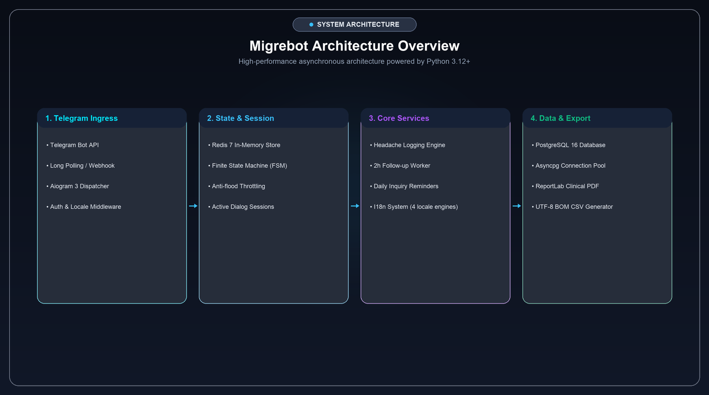
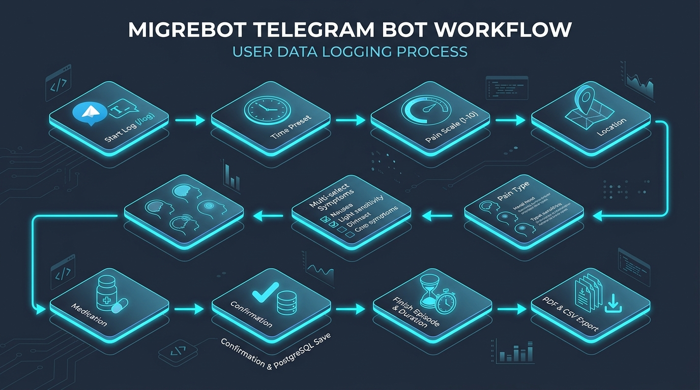
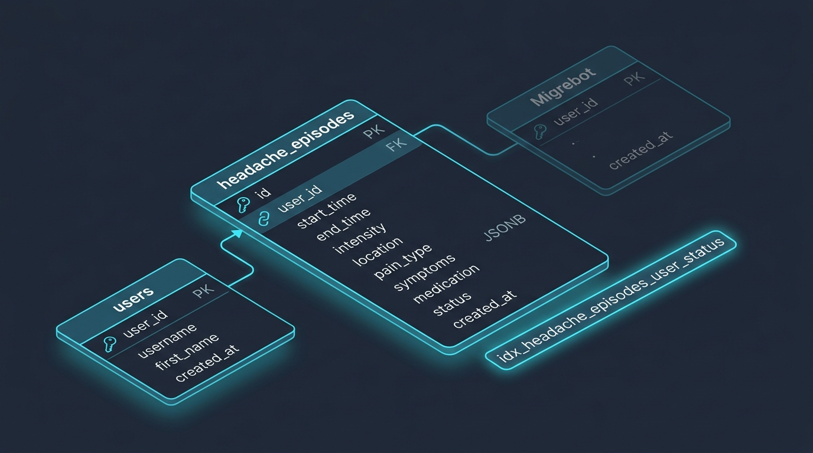

<div align="center">


# 🧠 Migrebot Analog
### Personal Telegram Headache & Migraine Diary Bot

[](https://www.python.org/)
[](https://docs.aiogram.dev/)
[](https://www.postgresql.org/)
[](https://redis.io/)
[](https://www.reportlab.com/)
[-brightgreen?style=for-the-badge&logo=pytest&logoColor=white)](tests/test_flow.py)
[](LICENSE)

<p align="center">
  <a href="README.md"><b>🇷🇺 Русский</b></a> &nbsp;•&nbsp; <b>🇬🇧 English</b>
</p>

<p align="center">
  <b>An intelligent bot for structured recording of symptoms, pain character and intensity,<br>
  automatic calculation of episode duration, and clinical report generation for neurologists.</b>
</p>

<p align="center">
  <a href="#-key-features">✨ Features</a> •
  <a href="#-system-architecture">📐 Architecture</a> •
  <a href="#-user-workflow--scenarios">🎮 Workflow</a> •
  <a href="#-tech-stack">🛠 Stack</a> •
  <a href="#-quick-start">⚙️ Quick Start</a> •
  <a href="#-testing">🧪 Testing</a> •
  <a href="#-server-deployment-systemd">🚀 Deployment</a> •
  <a href="#-database-schema">📋 Database</a>
</p>

</div>

---

## 📐 System Architecture

Fully asynchronous, fault-tolerant microservice architecture based on Python asyncio, distributed Redis FSM storage, and PostgreSQL:

<div align="center">
  
</div>

<br>

| Component | Technology | Responsibility |
| :--- | :--- | :--- |
| **Telegram Client** | Telegram Bot API | User interface: inline keyboards, multi-select checkboxes, reply menu |
| **Core Engine** | `aiogram 3.x` (Python) | Asynchronous message routing, callback processing, and FSM navigation |
| **Session Cache** | `Redis` (port `6532`) | Isolated FSM dialogue states via `DefaultKeyBuilder(with_bot_id=True)` |
| **Primary Database** | `PostgreSQL 14+` (`asyncpg`) | Persistent storage of user profiles and headache episodes (JSONB) |
| **Reporting Engine**| `ReportLab` + TTF Fonts | Medical PDF generation (A4 Landscape) and UTF-8 BOM CSV exports |

---

## 🌟 Key Features

### 1. ⏱ Step-by-Step FSM Headache Logger
- **Start Time**: Quick presets (*Right now, 30 min ago, 1 hour ago, 2 hours ago*) or manual custom time entry.
- **Pain Scale (1–10)**: Clear intensity rating from mild (1) to unbearable (10).
- **Localization**: Left side, right side, both sides, forehead and temples, back of head, diffuse pain.
- **Pain Character**: Throbbing, pressing/tightening, bursting, stabbing/shooting, dull/aching.
- **Multi-Select Symptoms**: Interactive inline checkboxes with instant live state updates (nausea, vomiting, photophobia, phonophobia, visual aura, dizziness, odor sensitivity).
- **Medication Taken**: Category selection (triptans, NSAIDs, combination analgesics, paracetamol) or custom drug entry.

### 2. ⏹ Automatic Duration Chronometry
- When pain subsides, tapping **«⏹ Finish episode»** records the end timestamp and calculates total duration (e.g. `2h 4m`).

### 3. 📥 Clinical Export for Neurologists
- 📄 **PDF Medical Report (Landscape A4)**: Clinical table with patient metadata, episode history, and aggregate statistics (average intensity, episode count). Full CJK and Cyrillic support via embedded `VL-Gothic` TrueType font.
- 📊 **CSV Table (Excel)**: UTF-8 BOM encoded spreadsheet with semicolon (`;`) delimiters — opens seamlessly in Excel and Google Sheets without encoding glitches.

### 4. 📊 Instant History Access
- On-demand history review of recent episodes directly in Telegram with clear status badges (🟢 completed / 🔴 active).

---

## 🎮 User Workflow & Scenarios

Interactive flow from initial recording to persistent storage and medical report generation:

<div align="center">
  
</div>

---

## ⌨️ Commands & Navigation

| Command | Menu Button | Description |
| :--- | :--- | :--- |
| `/start` | — | Personalized greeting with user name/nickname and auto-registration |
| `/log`, `/headache` | `🤕 Record episode` | Initiates the step-by-step FSM questionnaire |
| `/finish` | `⏹ Finish episode` | Closes the active episode and computes elapsed time |
| `/export` | `📥 Export report` | Report export menu (PDF / CSV / Both) |
| — | `📊 My episodes` | Displays the 5 most recent entries from diary |
| `/help` | `ℹ️ Help` | Comprehensive diary guide and documentation |
| `/cancel` | `❌ Cancel` | Aborts the active survey and returns to the main menu |

---

## 🛠 Tech Stack

- **Runtime**: Python 3.10+ / 3.13 (asynchronous event loop with `asyncio`)
- **Telegram Bot Framework**: `aiogram 3.31`
- **FSM State Engine**: `redis.asyncio` + `RedisStorage`
- **Database**: `PostgreSQL 14` + high-performance `asyncpg 0.31` driver
- **Reporting & Typography**: `ReportLab 4.4` with `DejaVuSans` & `VL-Gothic` TrueType fonts
- **Test Suite**: `unittest` (`IsolatedAsyncioTestCase` with `AsyncMock`)
- **Service Supervision**: `systemd` (Linux service with `PYTHONUNBUFFERED=1`)

---

## 📂 Project Structure

```text
migrebot_analog/
├── assets/
│   ├── fonts/             # TrueType fonts (DejaVuSans, VL-Gothic for CJK/Cyrillic)
│   └── images/            # Architecture diagrams, banners, and infographics
├── db/
│   ├── __init__.py        # Database interface exports
│   └── database.py        # Asynchronous PostgreSQL pool (asyncpg), DDL & CRUD
├── handlers/
│   ├── __init__.py        # Handlers root router
│   ├── startHandler.py    # /start, /help, and episode history handlers
│   ├── headache.py        # FSM logging flow and episode completion
│   └── exportHandler.py   # PDF and CSV export dispatcher (/export)
├── keyboards/
│   ├── __init__.py
│   ├── main_menu.py       # Persistent bottom reply keyboard
│   └── headache_kb.py     # Inline keyboards, callbacks, and navigation
├── services/
│   ├── __init__.py
│   └── export_service.py  # Medical PDF and CSV report builders with emoji cleaning
├── states/
│   ├── __init__.py
│   └── headache.py        # FSM states (HeadacheLogSG)
├── tests/
│   └── test_flow.py       # Comprehensive unit tests (FSM, DB, CJK export)
├── .env                   # Environment secrets (bot token, Redis, Postgres)
├── .gitignore             # Git ignored files and directories
├── requirements.txt       # Python dependencies
├── main.py                # Application entry point and polling dispatcher
├── README.md              # Russian documentation
└── README_en.md           # English documentation
```

---

## ⚙️ Quick Start

### 1. Clone & Setup Virtual Environment
```bash
git clone https://github.com/xanax01d/migrebot_analog.git
cd migrebot_analog

python3 -m venv venv
source venv/bin/activate
pip install --upgrade pip
pip install -r requirements.txt
```

### 2. Environment Configuration (`.env`)
Create a `.env` file in the project root:

```dotenv
# Telegram Bot Token (obtain from @BotFather)
TOKEN="your_telegram_bot_token"

# Redis Configuration (FSM)
RedisIP="127.0.0.1"
RedisPort=6532
RedisPassword="your_redis_password"

# PostgreSQL Configuration
POSTGRES_HOST=127.0.0.1
POSTGRES_PORT=5432
POSTGRES_USER=migrebot
POSTGRES_PASSWORD=your_pg_password
POSTGRES_DB=migrebot

# Network & Timeout Tuning
POSTGRES_SSL=disable
POSTGRES_TIMEOUT=10.0
POSTGRES_COMMAND_TIMEOUT=15.0
```

### 3. Start the Bot
```bash
python3 main.py
```

---

## 🧪 Testing

The repository contains an asynchronous unit test suite (`unittest.IsolatedAsyncioTestCase` with `AsyncMock` isolation) verifying the integrity of business logic, FSM transitions, navigation, database persistence, and export generation:

```bash
python3 -m unittest tests/test_flow.py -v
```

### Test Suite Structure (11 Tests):

| Test | Category | Verified Functionality |
| :--- | :--- | :--- |
| `test_nav_callbacks_packing` | 🧭 Navigation | Callback data packing for `hdn:back` ("Back") and `hdn:cancel` ("Cancel") |
| `test_navigation_buttons_presence_in_keyboards` | 🧭 Navigation | Verification of "Back" and "Cancel" buttons across all 8 questionnaire keyboards (including custom time entry) |
| `test_navigation_back_fsm_transitions` | 🧭 Navigation | Step-by-step backward FSM state transitions (`confirm` ➔ `medication` ➔ `symptoms` ➔ `pain_type` ➔ `location` ➔ `intensity` ➔ `start_time`, `custom_start_time` ➔ `start_time`) |
| `test_cancel_flow_clears_state` | 🧭 Navigation | Reliable FSM state clearing (`state.clear()`) on cancel button click and `/cancel` text command |
| `test_callback_packing` | 🔘 Keyboards | Correct prefixes and serialization of callbacks for all questionnaire steps (time, intensity, location, pain type, symptoms, medication, export) |
| `test_keyboards_structure` | 🔘 Keyboards | Validation of button layouts, captions, and callback payloads across all inline keyboards |
| `test_csv_and_pdf_generation` | 📄 Export | Generation of clinical PDF reports (ReportLab Landscape A4) and UTF-8 BOM CSV tables without errors |
| `test_cjk_and_nickname_export` | 📄 Export | Support for Cyrillic, Latin, CJK characters, and usernames via the `VL-Gothic` font stack |
| `test_redis_fsm_storage_config` | 🗄 Storage | Key namespace isolation for FSM states in Redis (`DefaultKeyBuilder(with_bot_id=True)`) |
| `test_postgres_dsn_generation` | 🗄 Database | Proper PostgreSQL DSN connection string generation with timeout and SSL settings |
| `test_postgres_db_lifecycle_mocked` | 🗄 Database | CRUD lifecycle: user profile registration, episode creation, history retrieval, and episode resolution |

---

## 🚀 Server Deployment (Systemd)

1. Clone project to `/opt/migrebot`:
   ```bash
   mkdir -p /opt/migrebot
   cd /opt/migrebot
   python3 -m venv venv
   ./venv/bin/pip install -r requirements.txt
   ```

2. Create service unit file `/etc/systemd/system/migrebot.service`:
   ```ini
   [Unit]
   Description=Migrebot Telegram Bot
   After=network.target redis-server.service postgresql.service
   Wants=redis-server.service postgresql.service

   [Service]
   Type=simple
   User=root
   WorkingDirectory=/opt/migrebot
   Environment=PYTHONUNBUFFERED=1
   ExecStart=/opt/migrebot/venv/bin/python3 main.py
   Restart=always
   RestartSec=5

   [Install]
   WantedBy=multi-user.target
   ```

3. Enable and start the service:
   ```bash
   systemctl daemon-reload
   systemctl enable migrebot.service
   systemctl start migrebot.service
   ```

4. Monitor status and live logs:
   ```bash
   systemctl status migrebot.service
   journalctl -u migrebot.service -f
   ```

---

## 📋 Database Schema

Relational structure in PostgreSQL with foreign keys, JSONB fields, and index optimization:

<div align="center">
  
</div>

<br>

Tables and indexes are automatically initialized on startup via `asyncpg`:

### `users`
| Column | Type | Description |
| :--- | :--- | :--- |
| `user_id` | `BIGINT PRIMARY KEY` | Unique Telegram user ID |
| `username` | `VARCHAR(255)` | Telegram username (@handle) |
| `first_name` | `VARCHAR(255)` | Profile first name |
| `created_at` | `TIMESTAMPTZ` | Timestamp of first interaction |

### `headache_episodes`
| Column | Type | Description |
| :--- | :--- | :--- |
| `id` | `BIGSERIAL PRIMARY KEY` | Episode auto-incrementing ID |
| `user_id` | `BIGINT REFERENCES users` | Owner reference |
| `start_time` | `VARCHAR(64)` | Onset timestamp |
| `end_time` | `VARCHAR(64)` | Resolution timestamp (null for active) |
| `intensity` | `SMALLINT` | Pain scale rating (1 to 10) |
| `location` | `VARCHAR(64)` | Pain localization zone |
| `pain_type` | `VARCHAR(64)` | Pain character type |
| `symptoms` | `JSONB` | List of selected symptoms (JSON array) |
| `medication` | `VARCHAR(255)` | Medication taken |
| `status` | `VARCHAR(32)` | Status: `active` or `completed` |
| `created_at` | `TIMESTAMPTZ` | Record creation timestamp |

*Index `idx_headache_episodes_user_status` on `(user_id, status)` ensures instant active episode lookups.*

---

<div align="center">
  <sub>Developed for health care and actionable medical consultations with neurologists.</sub>
</div>
